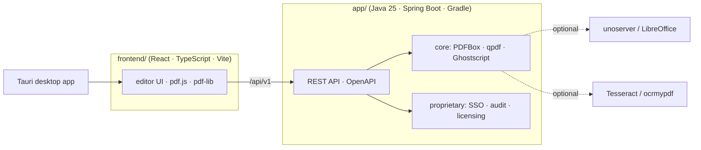

<h1 align="center">AziralPDF — self-hosted PDF platform</h1>

<p align="center">
  <a href="https://github.com/shutovBro/AziralPDF-app/actions/workflows/docker-publish.yml"></a>
  <a href="https://github.com/shutovBro/AziralPDF-app/pkgs/container/aziralpdf-app"></a>
  <a href="https://huggingface.co/spaces/shutovBro/aziralpdf"></a>
  
  
  
</p>

AziralPDF is a self-hosted PDF editing platform: view, annotate, sign, redact,
merge, split, compress, convert and automate PDFs — in the browser, as a desktop
app, or as a private REST API. Documents never leave your infrastructure.

**Live demo:** https://huggingface.co/spaces/shutovBro/aziralpdf
*(free CPU Space, ultra-lite build: no OCR / Office conversions, 50 MB upload cap)*

AziralPDF is a branded distribution of the MIT-licensed
[Stirling-PDF](https://github.com/Stirling-Tools/Stirling-PDF) engine, maintained
on the [`rebrand/aziralpdf`](https://github.com/shutovBro/AziralPDF-app/tree/rebrand/aziralpdf)
branch: AZIRAL branding and Russian localisation, the upstream update feed
disabled, `robots.txt` served, and a GHCR/Hugging Face deployment pipeline.
Upstream credits and licences are kept in [NOTICE.md](NOTICE.md) and [LICENSE](LICENSE).


## Key capabilities

- **Everywhere you work** — desktop client (Tauri), browser UI, and self-hosted server with a private API.
- **50+ PDF tools** — edit, merge, split, sign, redact, convert, OCR, compress, watermark, and more.
- **Automation & workflows** — no-code pipelines in the UI, REST endpoints for every tool.
- **Enterprise-grade** — SSO/SAML, audit log, flexible on-prem deployment.
- **Global UI** — 40+ languages.

## Architecture



Images: `docker/embedded/Dockerfile` (full), `Dockerfile.fat` (all converters bundled),
`Dockerfile.ultra-lite` (Java + embedded frontend only — what the demo runs).

## Quick start

```bash
# Prebuilt image (ultra-lite, built from this repository by GitHub Actions)
docker run -p 8080:8080 ghcr.io/shutovbro/aziralpdf-app:latest

# Full image with OCR + Office conversions, from source
docker compose -f docker/compose/docker-compose.yml up -d
```

Then open http://localhost:8080.

### Development

```bash
task install     # https://taskfile.dev — installs backend + frontend tooling
task dev         # backend on :8080, Vite dev server on :5173
```

See [DeveloperGuide.md](DeveloperGuide.md), [ADDING_TOOLS.md](ADDING_TOOLS.md)
and [CONTRIBUTING.md](CONTRIBUTING.md) for the full workflow, and
[docs/](docs) for deployment notes (Uptime Kuma, security, data extraction).

## Deployment

| Target | How |
|---|---|
| GHCR image | `.github/workflows/docker-publish.yml` builds `Dockerfile.ultra-lite` on every push and tags `latest` + `sha-<commit>` |
| Hugging Face demo | second job of the same workflow pushes `deploy/huggingface/` to the Space in the `HF_SPACE` variable |
| Kubernetes / bare metal | see the upstream [documentation](https://docs.stirlingpdf.com) — configuration keys are unchanged |

## License

Open-core: MIT for the core, see [LICENSE](LICENSE) and [NOTICE.md](NOTICE.md).
