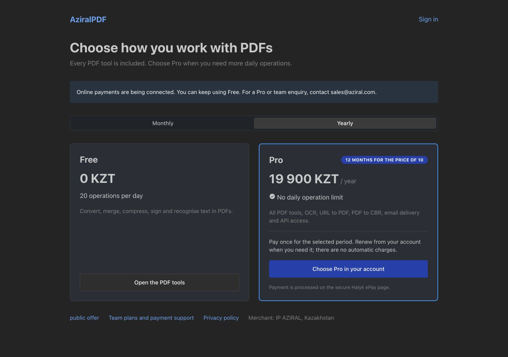
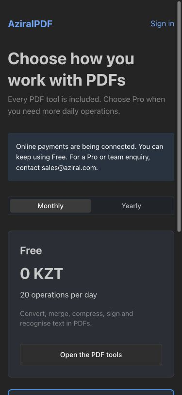

# AziralPDF production audit — 2026-10-15

Target: `https://pdf.aziral.com`. The audit covers production API processing, browser workflows,
authentication boundaries, registration, subscription logic, mail connectivity, legal links,
responsive layouts, source review and release checks. Production probes use repository PDF
fixtures and a separate disposable account; no customer documents are used.

## Defects corrected

| Finding | Correction |
| --- | --- |
| Authenticated users could enumerate all enabled accounts through the signing directory. | Default-team users see only themselves; named teams see enabled teammates; admins retain the complete directory. |
| Method-security denials became HTTP 500 errors. | Dedicated proprietary security advice returns HTTP 403 without internal rule details. |
| Watermarking without an explicit colour failed with a null-pointer exception. | Apply the documented default and handle null, empty and whitespace-only colours. |
| Registration API accepted passwords shorter than the form permits and malformed email addresses. | Enforce the existing six-character minimum, validate email syntax and compare duplicate emails without case sensitivity; hide internal registration exception details. |
| Refreshing a tool/settings URL sent the browser to login and lost the destination. | Allow GET/HEAD requests for the frontend shell through Spring Security; keep API and backend-only routes authenticated. |
| Three-segment checkout/signing links failed on direct requests. | Explicit SPA mappings serve the Halyk checkout and participant signing routes. |
| Russian-only language configuration removed English fallback and exposed billing message keys. | Keep `en-GB` as the translation fallback independently of the selected language; preserve the server default and user preference. |
| Authentication forms could be clipped on small/short screens; footer overlaid the form. | Use a bounded scrolling page, content-sized cards, responsive padding and a footer in normal flow. |
| Footer linked to the old repository and unrelated upstream survey/chat. | Use the current repository, AziralPDF legal defaults and wrapping footer links. |
| Public pricing did not expose the offer directly; some controls lacked accessible names. | Add the offer link, label password visibility and onboarding dismissal. |
| Legal documents contained stale source/offer/cookie links. | Use the current repository branch and local published legal URLs; retain the complete legal document set in deployment sources. |
| Demo image publishing targeted the previous GitHub owner. | Publish to `ghcr.io/azirali/aziralpdf-app`; update the optional demo image reference. |

The release also commits earlier session work: synchronous email attachment delivery, URL-to-PDF
process handling, a genuine stored RAR4 CBR writer, Halyk/Freedom Pay prepaid billing with
persistent invoice/payment records, account/pricing screens and production setup templates.

## Checks

- `JAVA_HOME=$(/usr/libexec/java_home -v 21) task backend:check`: formatting, tests and coverage gates.
- `task frontend:check`: TypeScript, ESLint, formatting and 734 passing tests in 63 files.
- Added regressions for account-directory isolation/admin access, permission errors, registration
  validation, missing watermark colour, SPA navigation/API protection and language fallback.
- Production: merge, rotate, split, compress, extract text, PDF-to-PNG/CBR/CBZ,
  add/remove password, OCR, URL-to-PDF, PDF-to-DOCX/HTML/PDF-A/PostScript,
  remove/reorder pages, crop, sanitise, repair, flatten forms and auto-rename.
- Validated generated PDFs/page counts, rotation, encryption and archive signatures/entries.
  Corrupt input and invalid rotation are rejected with HTTP 400.
- Free allowance: first 20 requests permitted, request 21 rejected with HTTP 429. An administrator
  temporarily grants Pro only to the disposable account for further testing.
- Browser: login using the test account, upload a fixture, rotate, inspect the result and
  download; the downloaded PDF has one page with the expected rotation.
- SMTP: certificate-verified STARTTLS and successful authentication (`235`), sender
  `AziralPDF <noreply@aziral.com>`. No new email sent during this audit. Earlier same-day delivery
  evidence is in `deploy/netcup/mail-sender-2026-10-15.json`.
- Validate workflow YAML/registry target locally and scan changed files for private credentials.

## Operational boundaries

Live Halyk payments and Apple Pay remain disabled pending merchant onboarding, credentials and
bank/device validation. No real payment, refund or bank account change is performed. The optional
Google Drive integration and scanner-effect feature require their own configuration/dependencies.
The existing Free quota counts processing attempts, is stored in memory and resets on process
restart; it is not a durable multi-instance usage ledger.

This is functional regression coverage, not a load test or a guarantee for every possible
malformed document, file size, external website or physical device. Actual Apple Pay and bank
settlement need separate acceptance testing after activation.

Production image, post-deployment checks, account cleanup and screenshots are recorded in
`2026-10-15-production.json` alongside this report.

## Published verification

The deployed image is `aziralpdf:audit-20261015-r3`. All 58 recorded HTTP checks passed,
including 24 PDF processing operations and the security/billing regressions. The first merge
request immediately following startup timed out; a later complete run succeeded and that
isolated timeout was not reproduced. This does not establish a load or latency guarantee.

Backend: 3,120 passed, 97 existing skips, zero failures/errors. Frontend: 734 passed.
Both Docker publishing runs completed successfully. The temporary account was deleted;
the eight original enabled-account summaries match the pre-audit fingerprint. The production
container is healthy and its build container is stopped.

